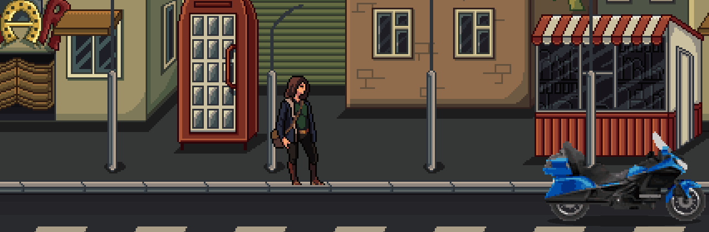

{.hero}

# Coffee

A short, quiet narrative game about the cages people build for themselves.

You live the same city week over and over, walking one street and talking to the same handful
of people. Each of them is stuck somewhere - in a job, a habit, a debt, a role. Listen, choose
what to say, and spend your time well: what you learn carries over from week to week, even when
the people you meet start again from scratch.

In development - coming soon

## What it's like

- Conversation is the game: no combat, no reflex tests.
- One street, a small cast, and stories that only open up over several weeks.
- Hand-drawn pixel art, a gentle soundtrack, and about an hour to play.
- Made for Windows; no install needed.

## Screenshots

{{screenshots}}

## Support the game

Coffee is made in our spare time. If you'd like to help, a tip goes a long way.

{{kofi}}

{{credits}}
