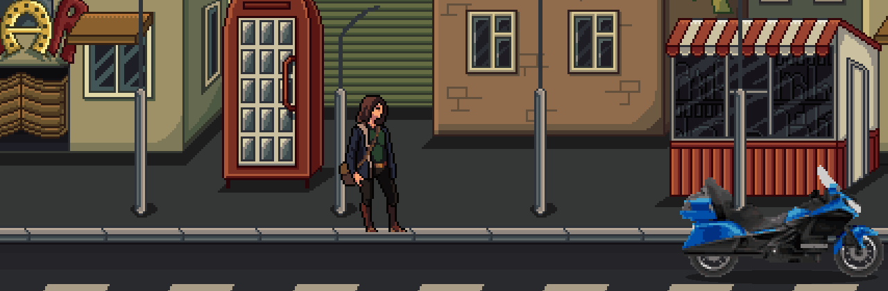

# 02 A timeline

22 Nov '26 . I have just hit publish on itch.io https://caged-squirrels.itch.io/coffee . I hope I have used an uninspiring name for my prototype game. 
Because I literally thought about it for 5 minutes. The prior prototype was literally called `Arcade_proto` . 
Anyway, the idea is now out there, give me some feedback on how easy it is to crash it. I'm mainly interrested in crashes, the game is incomplete, 
it's supposed to be. It's a stepping stone.
2 weeks ago , beginning November, I stopped work on the early prototype which was all about learning to package Python to executable and if Arcade 
would package up in there and work. Finally ready to code.

About a month earlier October '26 I finally wrote down a few chapters for the script of Caged Squirrels. 
It's only on my phone and in it's cloud, so all top secret.

Spring of 26 is when I decided to start, I only told a few folk at the time, but I had promosed myself in '25 , that I would finally write a game. 
So it took me about a year to actually write any code that will publish. which is not brilliant but proves I am quite pro at procrastinating. 
I invented the Pro in procrastinating, ask anyone who is <i>neurospicy</i> as they say, it's easy to put off stuff when your head is full of stuff

The rest of the timeline continues in the devblog below this one.

## Mac/linux

If I get enough donations in to cover costs of hosting and paying for images, tools and so on, I will "look" at linux support. 
I'm not going to until I know this is something worth doing, because I also have to look at Translation possibilities and how to implement those if at all possible. This is a game-engine shakedown.
Use the itch.io page to drop feedback and bugs please : https://caged-squirrels.itch.io/coffee

{.hero}
