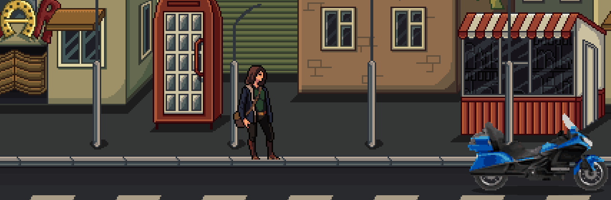

# 03 Ending and Sound

25 Nov '26 . An Epilogue has now been edited, some sound effects added, a few more are yet to come. 
But I need to get out again and record at least one or two more on my Zoom H4 recorder as I don't have a load of folley. 
Sound is super important and although the music is still rather flat, maybe that will also get tweaks as I go.
A few dialog nuances are still getting added as I play this though multiple times, and just get bored as can be, each time I test it.

I need to drop a Video playthrough, hate messing with screen recorders!

{.hero}
